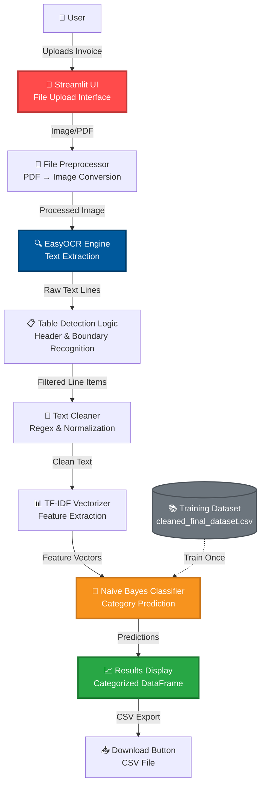

# InvoSpell 🪄

**AI-Powered Invoice Digitization & Categorization System**

[](https://www.python.org/)
[](https://streamlit.io/)
[](https://scikit-learn.org/)
[](https://github.com/JaidedAI/EasyOCR)
[](https://pandas.pydata.org/)

---

## 📹 Demo Video

<div align="center">

https://github.com/user-attachments/assets/20dcb5d5-17e2-44b3-90df-41c1d7a0176c

*InvoSpell in action - Upload, Extract, Categorize, Download*

</div>

---

## 🎯 Overview

**InvoSpell** is an intelligent invoice processing system that automatically extracts text from invoice images/PDFs using OCR technology and categorizes line items using machine learning. Built for accountants, finance teams, and businesses looking to automate expense tracking and invoice management.

### ✨ Key Features

- 🔍 **Intelligent OCR**: Extracts text from invoices (JPG, PNG, PDF) using EasyOCR with multi-language support
- 🧠 **Smart Categorization**: Machine learning-powered classification using TF-IDF and Naive Bayes
- 📊 **Table Detection**: Automatically identifies invoice table structures and extracts relevant line items
- 🎨 **Beautiful UI**: Clean, modern Streamlit interface with real-time processing feedback
- 📥 **CSV Export**: Download categorized results instantly for integration with accounting software
- ⚡ **Fast Processing**: Optimized pipeline for quick invoice digitization

---

## 🏗 System Architecture



---

## 🚀 Features Breakdown

### 📸 Intelligent OCR Pipeline
- **Multi-Format Support**: Handles JPG, JPEG, PNG, and PDF files
- **PDF to Image Conversion**: Automatically converts PDF invoices to images using `pdf2image`
- **High Accuracy Text Extraction**: Powered by EasyOCR with English language support
- **Confidence Filtering**: Only extracts text with >50% confidence scores

### 🧠 Smart Table Detection
- **Header Recognition**: Identifies common invoice headers (Item Description, Quantity, Unit Price, Total)
- **Boundary Detection**: Calculates table boundaries based on header positions
- **Row Filtering**: Extracts only relevant line items within table boundaries
- **Noise Removal**: Filters out totals, subtotals, addresses, and other non-item text

### 🎯 ML-Powered Categorization
- **TF-IDF Vectorization**: Converts text to numerical features for classification
- **Naive Bayes Classifier**: Fast and accurate multinomial classification
- **Pre-trained Model**: Uses `cleaned_final_dataset.csv` for training
- **Real-time Prediction**: Instant categorization of extracted line items

### 🎨 User Experience
- **Drag-and-Drop Upload**: Simple file upload interface
- **Real-time Progress**: Spinner animations during OCR and ML processing
- **Interactive Results**: Beautiful dataframe display with categorized items
- **One-Click Export**: Download results as CSV for further processing

---

## 🛠 Tech Stack

### Core Technologies
- **Python 3.8+** - Core programming language
- **Streamlit** - Web application framework for rapid UI development
- **EasyOCR** - Optical Character Recognition engine
- **scikit-learn** - Machine learning library (TF-IDF, Naive Bayes)

### Data Processing
- **Pandas** - Data manipulation and analysis
- **NumPy** - Numerical computations
- **Regex (re)** - Text cleaning and pattern matching

### Image Processing
- **PIL (Pillow)** - Image handling and manipulation
- **pdf2image** - PDF to image conversion
- **Poppler** - PDF rendering engine (required for pdf2image)

### Model Persistence
- **joblib** - Model and vectorizer serialization

---

## ⚡ Quick Start

### Prerequisites

Ensure you have the following installed:
- **Python 3.8+**
- **Poppler** (for PDF processing)
  - **Windows**: Download from [poppler releases](https://github.com/oschwartz10612/poppler-windows/releases) and add to PATH
  - **macOS**: `brew install poppler`
  - **Linux**: `sudo apt-get install poppler-utils`

### Installation

**1. Clone the Repository**
```bash
git clone https://github.com/your-username/invospell.git
cd invospell
```

**2. Create Virtual Environment**
```bash
python -m venv venv
source venv/bin/activate  # Windows: venv\Scripts\activate
```

**3. Install Dependencies**
```bash
pip install -r requirements.txt
```

**4. Prepare the Dataset**

Ensure you have `cleaned_final_dataset.csv` in the project root with the following format:
```csv
text,category
"Office Supplies - Pens and Notebooks",Office Supplies
"Marketing Campaign - Social Media Ads",Marketing
"Software Subscription - Adobe Creative Cloud",Software
```

**5. Run the Application**
```bash
streamlit run app.py
```

The app will open in your browser at `http://localhost:8501`

---

## 📦 Requirements

Create a `requirements.txt` file with:

```txt
streamlit>=1.28.0
pandas>=1.5.0
scikit-learn>=1.2.0
easyocr>=1.7.0
joblib>=1.3.0
Pillow>=10.0.0
pdf2image>=1.16.0
torch>=2.0.0
torchvision>=0.15.0
opencv-python-headless>=4.8.0
```

---

## 📂 Project Structure

```
invospell/
├── app.py                          # Main Streamlit application
├── cleaned_final_dataset.csv       # Training dataset
├── model.pkl                       # Trained Naive Bayes model (auto-generated)
├── vectorizer.pkl                  # TF-IDF vectorizer (auto-generated)
├── requirements.txt                # Python dependencies
├── README.md                       # Project documentation
└── assets/                         # Demo videos and screenshots (optional)
```

---

## 🎮 Usage Guide

### Step 1: Upload Invoice
- Click the file uploader
- Select an invoice (JPG, PNG, or PDF)
- Maximum file size: 200MB (configurable in Streamlit settings)

### Step 2: Automatic Processing
The system will:
1. Convert PDF to image (if applicable)
2. Run OCR to extract text
3. Detect invoice table boundaries
4. Filter and clean line items
5. Classify each item into categories

### Step 3: Review Results
- View categorized line items in an interactive table
- Each row shows:
  - **Line Item**: Extracted text description
  - **Predicted Category**: ML-assigned category

### Step 4: Export Data
- Click "📥 Download as CSV"
- Open in Excel, Google Sheets, or import to accounting software

---

## 🧪 Example Categories

The model categorizes invoice items into various expense categories such as:

- 💼 **Office Supplies**
- 💻 **Software & Technology**
- 📢 **Marketing & Advertising**
- 🚗 **Travel & Transportation**
- 🏢 **Rent & Utilities**
- 📞 **Communication**
- 🍽️ **Meals & Entertainment**
- 📚 **Training & Development**

*Categories depend on your training dataset structure*

---

## 🔧 Customization

### Adding New Categories

1. **Update Training Data**: Add examples to `cleaned_final_dataset.csv`
```csv
text,category
"Cloud Hosting - AWS EC2 Instances",Cloud Services
"Employee Training - Python Workshop",Training
```

2. **Retrain Model**: The model retrains automatically on app startup

3. **Adjust UI**: Modify category colors in the Streamlit CSS section

### Improving OCR Accuracy

```python
# In run_ocr() function, modify confidence threshold
if prob > 0.7:  # Increase from 0.5 for stricter filtering
    item_lines.append(cleaned_text)
```

### Multi-Language Support

```python
# Change EasyOCR language support
reader = easyocr.Reader(['en', 'es', 'fr'])  # English, Spanish, French
```

---

## 🐛 Troubleshooting

### Issue: "Poppler not found" error
**Solution**: Install Poppler and add to system PATH
```bash
# macOS
brew install poppler

# Ubuntu/Debian
sudo apt-get install poppler-utils

# Windows: Download and add to PATH
```

### Issue: OCR not detecting text
**Solution**: 
- Ensure invoice image is clear and high-resolution
- Check if text is in English (or add language support)
- Try increasing image contrast before upload

### Issue: Wrong categories predicted
**Solution**:
- Add more training examples to `cleaned_final_dataset.csv`
- Ensure category names are consistent
- Retrain model by restarting the app

---

## 🚀 Future Enhancements

- [ ] Multi-page PDF support
- [ ] Batch invoice processing
- [ ] Custom category training UI
- [ ] Integration with QuickBooks/Xero APIs
- [ ] Advanced table extraction (multi-column support)
- [ ] Confidence score display for predictions
- [ ] Historical invoice database with search
- [ ] Mobile app version

---

## 📄 License

MIT License - See [LICENSE](LICENSE) for details

---

## 👥 Contributing

Contributions are welcome! Please follow these steps:

1. Fork the repository
2. Create a feature branch (`git checkout -b feature/amazing-feature`)
3. Commit your changes (`git commit -m 'Add amazing feature'`)
4. Push to the branch (`git push origin feature/amazing-feature`)
5. Open a Pull Request

---

## 📧 Contact

For questions or support, please open an issue on GitHub or reach out via email.

---

<div align="center">

**🔮 Powered by AI Magic & Streamlit ✨**

Made with ❤️ for smarter expense tracking

</div>

